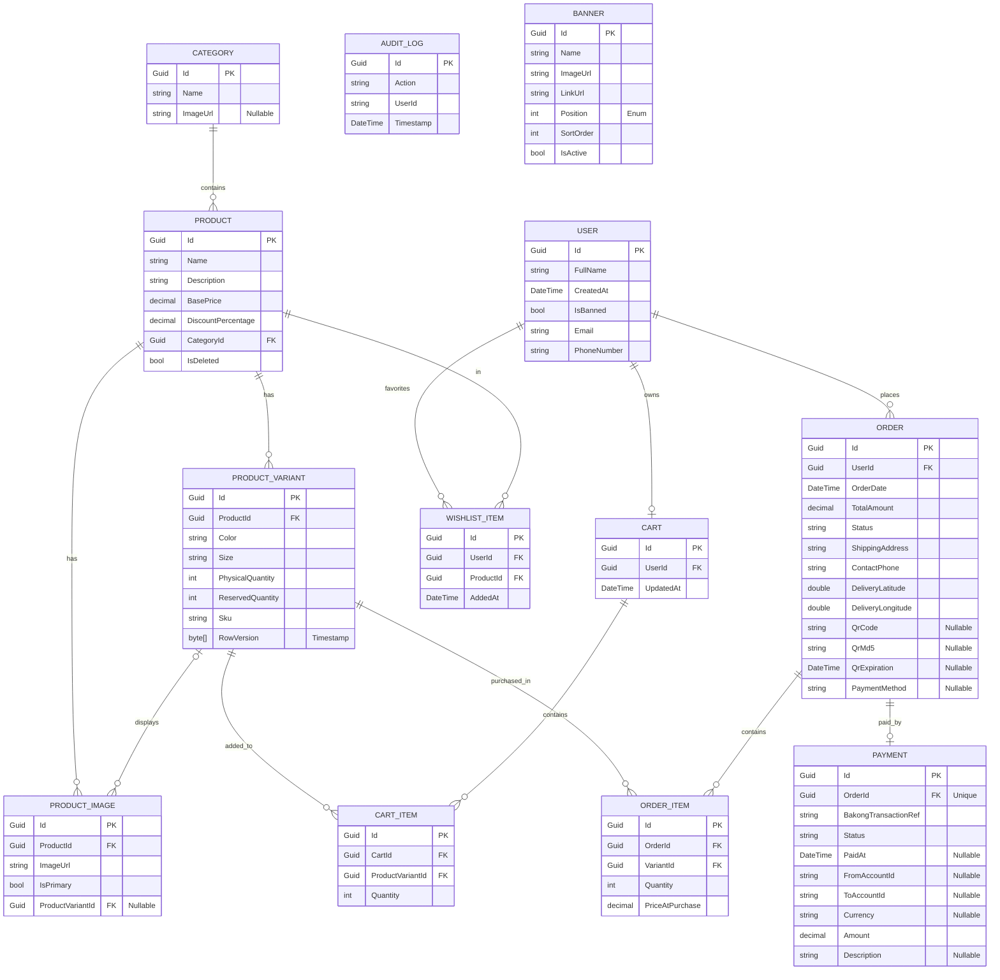

# Database Entity-Relationship Diagram (ERD) Documentation

This document describes the database schema, entity relationships, and architectural design choices implemented in the **Ecomerce-dotnet** project.

---

## 1. Visual Entity-Relationship Diagram

The following Mermaid diagram visualizes the tables, their columns, data types, primary keys (PK), foreign keys (FK), and relationship cardinalities.



---

## 2. Entity Definitions & Schema Reference

### 2.1. User
* **Model File**: [User.cs](file:///d:/Web-Development/ecomerce-dotnet/Ecomerce-dotnet/Ecomerce-dotnet/Models/User.cs)
* **Description**: Inherits from ASP.NET Core Identity's `IdentityUser<Guid>`. Mapped to the standard identity users table (`AspNetUsers`), providing robust authentication and authorization.
* **Fields**:
  * `Id` (Guid, PK): Unique identifier.
  * `FullName` (string): Full name of the user.
  * `CreatedAt` (DateTime): Timestamp when the account was registered.
  * `IsBanned` (bool): Indicates if the user account is suspended.

### 2.2. Category
* **Model File**: [Category.cs](file:///d:/Web-Development/ecomerce-dotnet/Ecomerce-dotnet/Ecomerce-dotnet/Models/Category.cs)
* **Description**: Mapped to product groups (e.g., Clothing, Electronics, Shoes) to organize catalog navigation.
* **Fields**:
  * `Id` (Guid, PK): Unique identifier.
  * `Name` (string): Name of the category.
  * `ImageUrl` (string, Nullable): URL path to category's banner/icon.

### 2.3. Product
* **Model File**: [Product.cs](file:///d:/Web-Development/ecomerce-dotnet/Ecomerce-dotnet/Ecomerce-dotnet/Models/Product.cs)
* **Description**: Holds global details of products before sizing, coloring, or custom physical parameters are selected.
* **Fields**:
  * `Id` (Guid, PK): Unique identifier.
  * `Name` (string): Product title.
  * `Description` (string): Rich details of the product.
  * `BasePrice` (decimal): Selling price before calculations (configured to `decimal(18,2)` precision).
  * `DiscountPercentage` (decimal): Running discount percentage (configured to `decimal(5,2)` precision).
  * `CategoryId` (Guid, FK): References the category this product belongs to.
  * `IsDeleted` (bool): Soft delete flag.

### 2.4. ProductVariant
* **Model File**: [ProductVariant.cs](file:///d:/Web-Development/ecomerce-dotnet/Ecomerce-dotnet/Ecomerce-dotnet/Models/ProductVariant.cs)
* **Description**: The distinct SKU (Stock Keeping Unit) combination containing specific attributes like Color, Size, and physical stock quantities.
* **Fields**:
  * `Id` (Guid, PK): Unique SKU identifier.
  * `ProductId` (Guid, FK): References the parent product.
  * `Color` (string): Color attribute.
  * `Size` (string): Size attribute (e.g. "XL", "42").
  * `PhysicalQuantity` (int): Number of items sitting in the physical warehouse.
  * `ReservedQuantity` (int): Number of items held during pending checkouts.
  * `Sku` (string): Human-readable SKU tracking string.
  * `RowVersion` (byte[], Timestamp): Used for Optimistic Concurrency Control to handle race conditions during flash sales.

### 2.5. ProductImage
* **Model File**: [ProductImage.cs](file:///d:/Web-Development/ecomerce-dotnet/Ecomerce-dotnet/Ecomerce-dotnet/Models/ProductImage.cs)
* **Description**: Images showing the product. Can either belong generally to a product or specifically highlight a color variant.
* **Fields**:
  * `Id` (Guid, PK): Unique identifier.
  * `ProductId` (Guid, FK): References the parent product.
  * `ImageUrl` (string): Location reference of the file asset.
  * `IsPrimary` (bool): Defines if it is the main thumbnail.
  * `ProductVariantId` (Guid, FK, Nullable): Optional link to specific variant color/size representation.

### 2.6. Cart
* **Model File**: [CartItem.cs](file:///d:/Web-Development/ecomerce-dotnet/Ecomerce-dotnet/Ecomerce-dotnet/Models/CartItem.cs) (Contains both Cart & CartItem)
* **Description**: Persistent shopping cart assigned to an authenticated user.
* **Fields**:
  * `Id` (Guid, PK): Unique identifier.
  * `UserId` (Guid, FK): References the owning user.
  * `UpdatedAt` (DateTime): Tracked to allow cleanup of inactive or abandoned carts.

### 2.7. CartItem
* **Model File**: [CartItem.cs](file:///d:/Web-Development/ecomerce-dotnet/Ecomerce-dotnet/Ecomerce-dotnet/Models/CartItem.cs)
* **Description**: Individual lines of products inside a cart, linked specifically to `ProductVariant` to preserve selections (size/color).
* **Fields**:
  * `Id` (Guid, PK): Unique identifier.
  * `CartId` (Guid, FK): References the parent Cart.
  * `ProductVariantId` (Guid, FK): References the specific size/color combination.
  * `Quantity` (int): Number of units selected.

### 2.8. WishlistItem
* **Model File**: [WishlistItem.cs](file:///d:/Web-Development/ecomerce-dotnet/Ecomerce-dotnet/Ecomerce-dotnet/Models/WishlistItem.cs)
* **Description**: Favorites list. Links the user directly to the general `Product` (since users usually favorite the product page, selecting details only during checkout).
* **Fields**:
  * `Id` (Guid, PK): Unique identifier.
  * `UserId` (Guid, FK): References the favoriting User.
  * `ProductId` (Guid, FK): References the favorited general Product.
  * `AddedAt` (DateTime): Timestamp of adding to favorites.

### 2.9. Order
* **Model File**: [Order.cs](file:///d:/Web-Development/ecomerce-dotnet/Ecomerce-dotnet/Ecomerce-dotnet/Models/Order.cs)
* **Description**: Main order record containing delivery coordinates, address details, totals, and state.
* **Fields**:
  * `Id` (Guid, PK): Unique identifier.
  * `UserId` (Guid, FK): References the customer.
  * `OrderDate` (DateTime): Order placement timestamp.
  * `TotalAmount` (decimal): Final grand total (configured to `decimal(18,2)` precision).
  * `Status` (string): State tracker (e.g. `Pending`, `Paid`, `Shipped`, `Cancelled`).
  * `ShippingAddress` (string): Plaintext shipping address.
  * `ContactPhone` (string): Telephone contact number.
  * `DeliveryLatitude` (double) / `DeliveryLongitude` (double): Geospatial coordinates for maps integration.
  * `QrCode` (string, Nullable) / `QrMd5` (string, Nullable): Bakong KHQR payment link and transaction confirmation hash.
  * `QrExpiration` (DateTime, Nullable): Expiry timestamp of the generated KHQR code.
  * `PaymentMethod` (string, Nullable): Selection tracker (e.g. `"khqr"`).

### 2.10. OrderItem
* **Model File**: [OrderItem.cs](file:///d:/Web-Development/ecomerce-dotnet/Ecomerce-dotnet/Ecomerce-dotnet/Models/OrderItem.cs)
* **Description**: Snapshot record of products ordered, recording specific price paid.
* **Fields**:
  * `Id` (Guid, PK): Unique identifier.
  * `OrderId` (Guid, FK): References the parent Order.
  * `VariantId` (Guid, FK): References the purchased ProductVariant.
  * `Quantity` (int): Number of items purchased.
  * `PriceAtPurchase` (decimal): Snapshot price at purchase to prevent historical issues if prices are changed later.

### 2.11. Payment
* **Model File**: [Payment.cs](file:///d:/Web-Development/ecomerce-dotnet/Ecomerce-dotnet/Ecomerce-dotnet/Models/Payment.cs)
* **Description**: Payment audit log. Links 1-to-1 with an `Order` and holds response payloads from the payment gateway.
* **Fields**:
  * `Id` (Guid, PK): Unique identifier.
  * `OrderId` (Guid, FK, Unique): References the paid Order.
  * `BakongTransactionRef` (string): Transaction hash returned from Bakong KHQR gateway.
  * `Status` (string): State tracker (e.g. `Pending`, `Success`, `Failed`).
  * `PaidAt` (DateTime, Nullable): Completion timestamp.
  * `FromAccountId` / `ToAccountId` (string, Nullable): Gateway-specific audit coordinates.
  * `Currency` (string, Nullable) / `Amount` (decimal): Payment value validation fields.
  * `Description` (string, Nullable): Audit message notes.

### 2.12. AuditLog
* **Model File**: [AuditLog.cs](file:///d:/Web-Development/ecomerce-dotnet/Ecomerce-dotnet/Ecomerce-dotnet/Models/AuditLog.cs)
* **Description**: Tracks administrative actions for compliance and trace records (e.g. product changes, manual bans).
* **Fields**:
  * `Id` (Guid, PK): Unique identifier.
  * `Action` (string): Short action code.
  * `UserId` (string): Reference of operator who executed the change.
  * `Timestamp` (DateTime): Execution time.

### 2.13. Banner
* **Model File**: [Banner.cs](file:///d:/Web-Development/ecomerce-dotnet/Ecomerce-dotnet/Ecomerce-dotnet/Models/Banner.cs)
* **Description**: Controls front-end carousel placements and promotional popups.
* **Fields**:
  * `Id` (Guid, PK): Unique identifier.
  * `Name` (string): Internal admin tracker.
  * `ImageUrl` (string): Image file location.
  * `LinkUrl` (string): Destination path.
  * `Position` (BannerPosition Enum): Defines banner placement (e.g., `HomePageHero` = 1, `AllProductsTop` = 2, `CartPageBottom` = 3, `PromotionPopup` = 4).
  * `SortOrder` (int): Ordering sequence value.
  * `IsActive` (bool): Filter flag.

---

## 3. Key Database & Relationship Design Choices

### 3.1. Stock Split: Physical vs. Reserved Quantity
In [ProductVariant.cs](file:///d:/Web-Development/ecomerce-dotnet/Ecomerce-dotnet/Ecomerce-dotnet/Models/ProductVariant.cs), the inventory is split into:
1. `PhysicalQuantity`: Total items present in the warehouse.
2. `ReservedQuantity`: Items locked inside unpaid checkout windows or cart reservation holds.

This design enables a computed `AvailableStock => PhysicalQuantity - ReservedQuantity` calculation. It avoids blocking items long-term (e.g. if a user abandons checkout, the reservation simply expires, returning items to the pool without manual inventory checks).

### 3.2. Optimistic Concurrency Control (`RowVersion`)
To protect inventory levels during high-traffic events (such as flash sales), `ProductVariant` includes a `RowVersion` timestamp field decorated with the `[Timestamp]` attribute:
```csharp
[Timestamp]
public byte[] RowVersion { get; set; } = Array.Empty<byte>();
```
If two processes retrieve the same stock row and attempt to subtract inventory concurrently, Entity Framework throws a `DbUpdateConcurrencyException` on the second transaction, preventing double-allocations or overselling.

### 3.3. Prevent Cascade Delete Loops on OrderItems
By default, deleting a `ProductVariant` could cause a cascade delete trigger on `OrderItems` which in turn affects `Orders`. To avoid breaking financial records, cascade behavior is explicitly disabled in [ApplicationDbContext.cs](file:///d:/Web-Development/ecomerce-dotnet/Ecomerce-dotnet/Ecomerce-dotnet/Data/ApplicationDbContext.cs):
```csharp
modelBuilder.Entity<OrderItem>()
    .HasOne(oi => oi.ProductVariant)
    .WithMany()
    .HasForeignKey(oi => oi.VariantId)
    .OnDelete(DeleteBehavior.Restrict); // Prevent Cascade Delete loops
```

### 3.4. Cart vs. Wishlist Association Logic
* **`CartItem` -> `ProductVariant`**: A shopping cart line represents a physical intent to buy. Therefore, it requires color and size selections to accurately track quantities and calculate shipment volumes.
* **`WishlistItem` -> `Product`**: Wishlists represent a customer's bookmarking behavior. Rather than forcing a user to lock in a size/color, the bookmark tracks the general product, prompting them to select a variant only when transferring the item to the cart.

### 3.5. Order-Payment 1-to-1 Relationship
The schema establishes a strict 1-to-1 relationship configuration in EF Core:
```csharp
modelBuilder.Entity<Order>()
    .HasOne(o => o.Payment)
    .WithOne(p => p.Order)
    .HasForeignKey<Payment>(p => p.OrderId);
```
An order possesses at most one billing log, eliminating the potential for duplicate charging references for the same purchase request.

### 3.6. Soft Deletion on Products
Products utilize soft deletion (`IsDeleted = false`). This prevents breaking foreign-key references in legacy orders or analytics when an item is retired from active sales.
